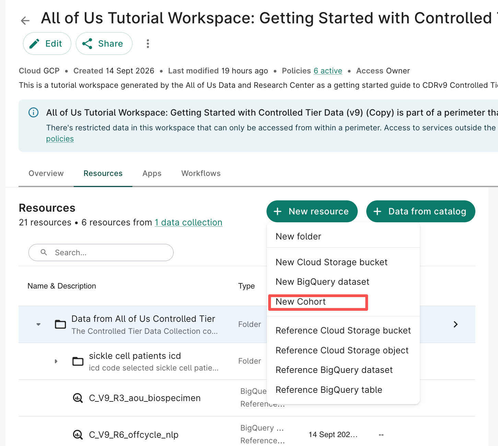
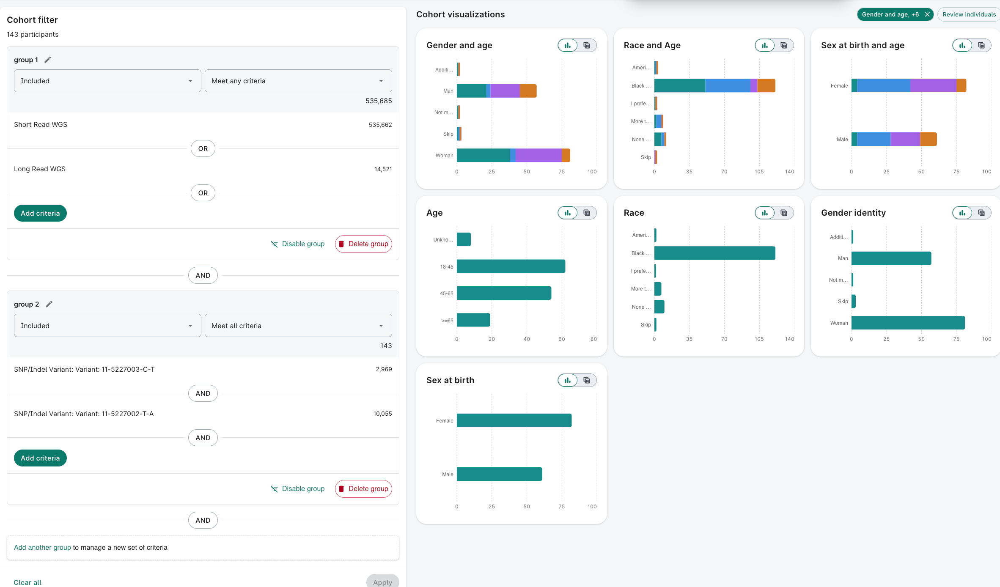
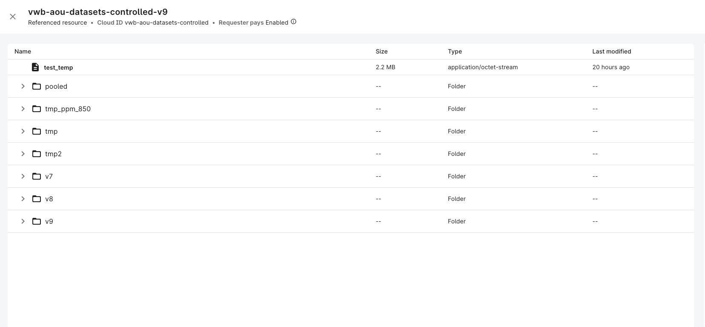
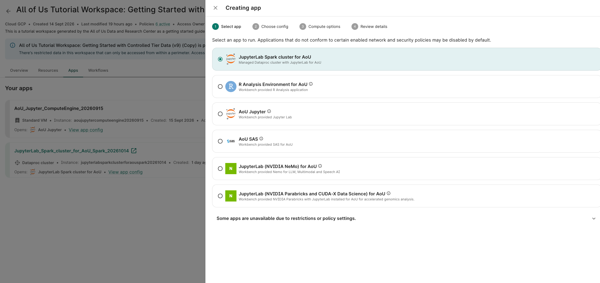
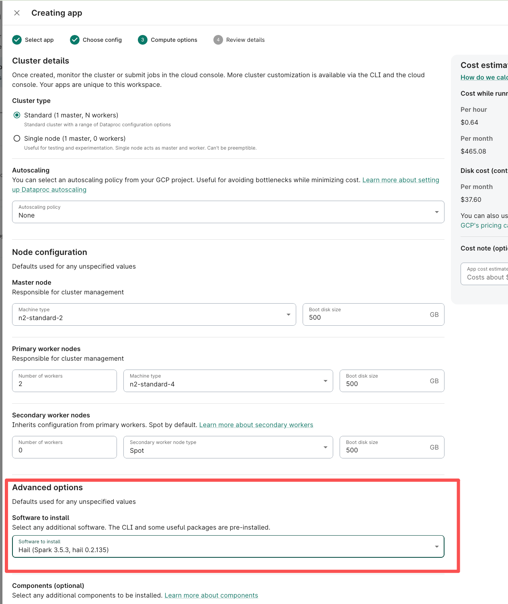

# All of Us Researcher Workbench Practical Guide

A practical guide to onboarding, cohort construction, genomic data access, computational environments, and cloud storage in the All of Us Researcher Workbench.

This guide is intended for researchers starting clinical, genomic, or multi-omic analyses. It combines practical workflow notes with links to official documentation. Screenshots reflect the author's workspace in October 2026; available apps, dataset paths, and interface labels may change.

**Documentation date:** October 15, 2026  
**Scope:** A user-written tutorial, not an official All of Us manual or a complete executable analysis pipeline.

## Contents

1. [Registration and access](#1-registration-and-access)
2. [Documentation and support](#2-documentation-and-support)
3. [Cohort construction](#3-cohort-construction)
4. [Genomic and multi-omic data](#4-genomic-and-multi-omic-data)
5. [Computational environments and costs](#5-computational-environments-and-costs)
6. [Cloud storage and file organization](#6-cloud-storage-and-file-organization)
7. [A reproducible workflow](#7-a-reproducible-workflow)
8. [Repository contents](#8-repository-contents)

## 1. Registration and access

### Onboarding

Start registration using an institutional email associated with an eligible organization. Complete the required identity verification, training, and data-use agreements for your intended access tier.

Registration email and Workbench login credentials are not necessarily the same. The current official guide describes signing in with the assigned `@researchallofus.org` credentials. Follow the [Getting Started Guide](https://support.researchallofus.org/hc/en-us/articles/41981050556564-Researcher-Workbench-Getting-Started-Guide) for the current login and workspace setup process.

### Access tiers

| Tier | Typical use | Data considerations |
| --- | --- | --- |
| Registered Tier | Epidemiology, clinical phenotypes, descriptive and population studies | Includes privacy-transformed clinical, survey, measurement, and other available non-genomic data |
| Controlled Tier | Statistical genetics, GWAS, genomic and multi-omic research | Includes genomic resources and more granular information, subject to authorization and release-specific availability |

If you anticipate genomic analyses, complete the applicable Controlled Tier requirements early. Confirm that the relevant data collection has been added to your workspace; account authorization alone does not configure the workspace's analysis resources.

## 2. Documentation and support

| Resource | Use |
| --- | --- |
| [Researcher Workbench Getting Started Guide](https://support.researchallofus.org/hc/en-us/articles/41981050556564-Researcher-Workbench-Getting-Started-Guide) | Login, workspace setup, data collections, apps, and billing |
| [Data Dictionaries](https://support.researchallofus.org/hc/en-us/articles/360033200232-Data-Dictionaries) | Release-specific tables, variables, and metadata |
| [Metadata Reference Spreadsheet](https://docs.google.com/spreadsheets/d/1GKvrdnvOfzFW4yFveJL__c5mlZk_y6o7Pn8-8DZyYWs/edit?gid=1878710977) | Supplementary table and field reference linked in the source tutorial |
| [Getting Started with Genomic Analyses](https://support.researchallofus.org/hc/en-us/articles/30914634409876-Getting-Started-with-Genomic-Analyses-on-the-Researcher-Workbench) | Hail and genomic analysis guidance; check platform and release applicability |
| [Using dsub](https://support.researchallofus.org/hc/en-us/articles/4692986669332-Use-dsub-in-the-All-of-Us-Researcher-Workbench) | Background on container-based batch jobs; check compatibility with your current environment |
| [All of Us User Support Hub](https://support.researchallofus.org/hc/en-us) | Troubleshooting, support requests, and office-hours information |

Consult the data dictionary before selecting variables or writing phenotype queries. Some tutorials describe older Workbench environments, so verify that their commands, authentication, and paths match your workspace.

## 3. Cohort construction

### Create a cohort

1. Open the research workspace and confirm the intended data collection and release.
2. Open **Resources** and select **New resource → New Cohort**, as illustrated below, or use the available Data Explorer cohort interface.
3. Define inclusion and exclusion criteria.
4. Check the logic connecting criteria and groups.
5. Review participant counts and demographic summaries.
6. Save the cohort definition for subsequent analyses.



### Understand AND and OR

- **OR / Meet any criteria:** a participant can satisfy any listed condition.
- **AND / Meet all criteria:** a participant must satisfy every listed condition.
- Group-level connections determine how separate sets of criteria are combined.

For example:

```text
(Short-read WGS OR Long-read WGS)
AND
(Variant criterion A AND Variant criterion B)
```



The screenshot illustrates a particular cohort with 143 participants. It is an interface example, not a recommended disease definition. Matching two variant criteria alone does not establish a clinical diagnosis or phased genotype.

### Record the phenotype definition

For each analysis, document:

- Data release and cohort creation date.
- Diagnosis concepts, codes, or variant criteria used.
- Inclusion/exclusion logic and any time windows.
- Case/control coding and treatment of missing information.
- Sample counts before and after matching clinical and genomic data.

## 4. Genomic and multi-omic data

### Source data and releases

The source tutorial uses this program-managed Controlled Tier bucket:

```text
gs://vwb-aou-datasets-controlled
```



Use the authorized data resources attached to your workspace to identify the actual release-specific objects. The displayed resource name can differ from its underlying bucket ID. A visible folder is not evidence that every file is supported for your analysis.

This tutorial uses **CDR v9 examples**. Check the [Data Dictionaries](https://support.researchallofus.org/hc/en-us/articles/360033200232-Data-Dictionaries) for the release you select. Do not assume that paths, annotations, or helper files from v8 remain unchanged in v9.

Before starting a large analysis, confirm:

- The data release and reference genome assembly.
- Dataset availability and access permissions.
- Required variant, sample, and annotation files.
- Input format and compatibility with the analysis software.

### Genomic formats and Hail

Hail supports scalable sample/variant filtering, quality control, PCA, and association testing. MatrixTables and VariantDatasets are useful for distributed genomic analyses when available in the selected release.

Start with a small sample or genomic interval to check file access, schemas, and analysis logic before processing the full dataset. Avoid repeatedly copying or converting the entire WGS dataset when a suitable subset or existing Hail representation can be used.

### Multi-omic availability

Availability of transcriptomic, proteomic, and other molecular resources depends on the release, data collection, and authorization. Check the selected release's documentation rather than assuming that all modalities are present for every participant.

## 5. Computational environments and costs

Applications are configured through the workspace's **Apps** section.



### Choose an environment

| Environment | Typical tasks |
| --- | --- |
| Standard JupyterLab | Clinical data processing, phenotype development, exploratory analysis, plotting, and manageable statistical analyses |
| JupyterLab with Spark | Distributed genomic processing, large Hail MatrixTables or VariantDatasets, genomic QC, PCA, and association testing |
| Batch execution | Repeatable non-interactive tasks, where supported by the current workspace and policies |

For the Hail workflow shown in the source tutorial, choose **JupyterLab Spark cluster for AoU** and select Hail under **Advanced options → Software to install**.



The screenshot shows one configuration, including Spark 3.5.3 and Hail 0.2.135. These are historical example settings, not a required or universally optimal configuration. Machine sizes, worker counts, and disk sizes should be chosen for the workload.

### Manage costs

Review the current compute and storage estimates before launching an app. Prices in the screenshot are illustrative and should not be used as a current quote.

Practical habits:

- Test workflows on a small subset before increasing resources.
- Save durable outputs before stopping or deleting an environment.
- Use the Workbench controls to stop unused compute; closing a browser tab does not establish that compute has stopped.
- Review remaining storage and disk resources as well as active compute.
- Keep a record of runtime, configuration, and cost for repeated jobs.

Consult the billing section of the [Getting Started Guide](https://support.researchallofus.org/hc/en-us/articles/41981050556564-Researcher-Workbench-Getting-Started-Guide) for the current platform workflow.

## 6. Cloud storage and file organization

### Distinguish source data from analysis outputs

| Storage | Purpose |
| --- | --- |
| Program-managed data resources | Authorized source datasets and release-specific resources |
| Workspace/project bucket | Your analysis inputs, intermediate files, logs, and results |
| Notebook local disk | Working files whose persistence depends on the environment |

Example project bucket:

```text
gs://your-workspace-bucket
```

The `WORKSPACE_BUCKET` environment variable may be available, depending on the environment. Check it rather than assuming it is set:

```python
import os

workspace_bucket = os.environ.get("WORKSPACE_BUCKET")
if workspace_bucket:
    print(workspace_bucket)
else:
    print("WORKSPACE_BUCKET is not set. Find the output bucket in workspace Resources.")
```

### Suggested project organization

The following is a suggested layout, not an existing directory listing:

```text
gs://your-workspace-bucket/project-name/
├── input/          # Phenotypes, covariates, and sample lists
├── intermediate/   # Reusable intermediate datasets
├── results/        # Final analysis outputs
├── figures/        # Analysis figures
└── logs/           # Run logs and completion summaries
```

Use unique run identifiers or versioned output prefixes when repeating an analysis. A GCS folder is an object-name prefix; it does not need to be created as a local directory first.

### Illustrative terminal commands

If `gsutil` is installed and authenticated in your authorized Workbench environment, replace these placeholders with your actual project paths:

```bash
# List project outputs.
gsutil ls 'gs://your-workspace-bucket/project-name/results/'

# Save a local run log to project storage.
gsutil cp ./run.log 'gs://your-workspace-bucket/project-name/logs/run.log'
```

These examples are for workspace storage operations. Follow the applicable All of Us rules for data movement and sharing; moving files to a public repository is a separate action from saving them to an authorized workspace bucket.

## 7. A reproducible workflow

1. Complete onboarding and add the appropriate data collection.
2. Record the selected release and reference assembly.
3. Define and save the cohort and phenotype logic.
4. Confirm genomic and clinical sample identifiers match.
5. Launch an appropriate environment and record software versions.
6. Test access and analysis on a small subset.
7. Run the full workflow with logs and versioned output paths.
8. Validate expected outputs and sample/variant counts.
9. Save results to durable workspace storage and stop unused compute.

For long-running analyses, distinguish an individual Spark stage's progress from completion of the entire pipeline. Confirm successful completion through application logs and validated outputs, not merely the presence of an output prefix.

## 8. Repository contents

```text
README.md
assets/
├── create-cohort.png
├── cohort-filters.png
├── genomic-storage.png
├── choose-app.png
└── spark-hail-configuration.png
```

Upload `README.md` and the `assets/` folder together, preserving this structure so GitHub renders the images. This tutorial package contains documentation and screenshots; it does not include a complete executable workflow or participant-level data files.
